# GoCollab

**System Architecture, Flowcharts & Database Design**

| | |
|---|---|
| **Project** | GoCollab — GDGoC Philippines Community Management Platform |
| **Stack** | Flutter · Riverpod · Supabase · Google Calendar API · GitHub API |
| **Version** | 1.0.0 · Generated August 2026 |

> **PDF export:** Open [`GoCollab-Architecture-and-Schema.html`](GoCollab-Architecture-and-Schema.html) in Chrome → Print → Save as PDF, or use the pre-generated [`GoCollab-Architecture-and-Schema.pdf`](GoCollab-Architecture-and-Schema.pdf).

## Contents

1. [System Architecture](#1-system-architecture)
2. [Clean Architecture Layers](#2-clean-architecture-layers)
3. [Role-Based Navigation](#3-role-based-navigation)
4. [Use Case Diagrams](#4-use-case-diagrams)
5. [System Flowcharts](#5-system-flowcharts)
6. [Entity-Relationship Diagram (ERD)](#6-entity-relationship-diagram-erd)
7. [Database Table Reference](#7-database-table-reference)
8. [Storage Buckets & Security](#8-storage-buckets--security)

---

## 1. System Architecture

GoCollab follows a **3-tier architecture**: Flutter client, Supabase backend (BaaS), and external APIs. The client uses Clean Architecture with Riverpod state management.

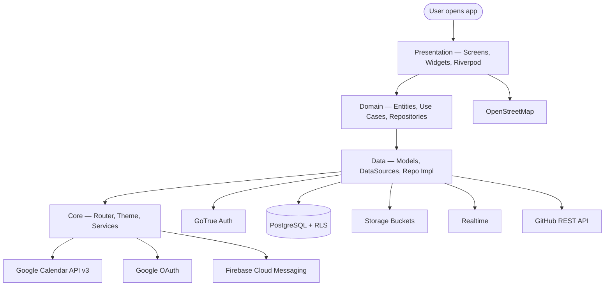

## 2. Clean Architecture Layers

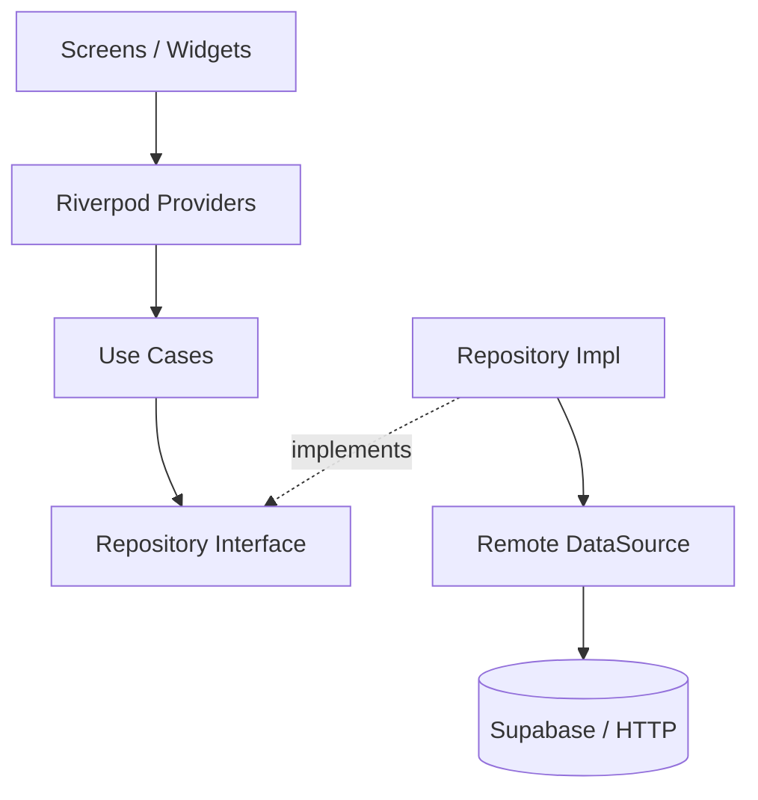

## 3. Role-Based Navigation

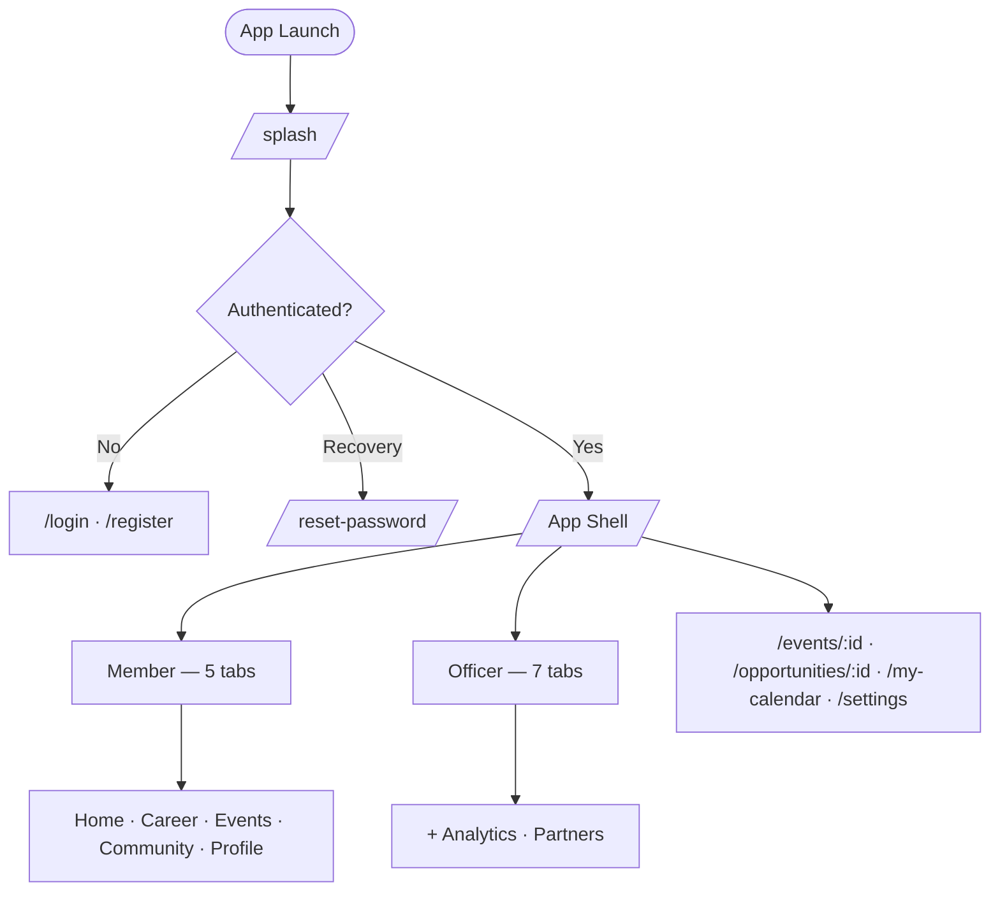

## 4. Use Case Diagrams

Primary actors are **Member** and **Officer**. Officers inherit all member capabilities and add management use cases. Secondary actors are external systems (Google, GitHub, FCM, Supabase).

### 4.1 Combined Use Case Diagram

Members access read/participate features only. Officers access everything members can, plus management use cases.

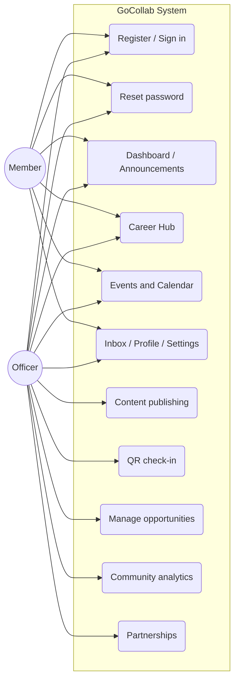

### 4.2 Member Use Cases (Detail)

```mermaid
flowchart TD
    Member((Member))

    subgraph GoCollab["GoCollab System"]
      UC01(Register / Sign in)
      UC02(Reset password)
      UC03(View dashboard)
      UC04(Browse announcements)
      UC05(Browse opportunities)
      UC06(Save opportunity)
      UC07(Browse events)
      UC08(Register for event)
      UC09(View QR ticket)
      UC10(Sync to Google Calendar)
      UC11(View My Calendar)
      UC12(Read notifications)
      UC13(Manage profile)
      UC14(View GitHub stats)
      UC15(View certificates)
      UC16(Open settings / sign out)
    end

    Member --> UC01
    Member --> UC02
    Member --> UC03
    Member --> UC04
    Member --> UC05
    Member --> UC06
    Member --> UC07
    Member --> UC08
    Member --> UC09
    Member --> UC10
    Member --> UC11
    Member --> UC12
    Member --> UC13
    Member --> UC14
    Member --> UC15
    Member --> UC16
```

### 4.3 Officer Use Cases (Detail)

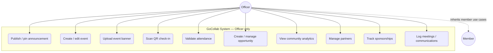

### 4.4 External System Actors

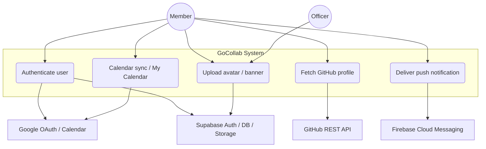

### 4.5 Use Case Summary

| ID | Use Case | Actor | Description |
|---|---|---|---|
| UC01 | Register / Sign in | Member, Officer | Email/password or Google Sign-In via Supabase Auth |
| UC02 | Reset password | Member, Officer | Forgot-password email + PKCE recovery flow |
| UC03–UC04 | Dashboard / Announcements | Member, Officer | View feed, upcoming events, community stats |
| UC05–UC06 | Career Hub | Member, Officer | Browse/filter opportunities; bookmark |
| UC07–UC11 | Events & Calendar | Member, Officer | Register, QR ticket, Google Calendar sync, My Calendar |
| UC12–UC16 | Inbox / Profile / Settings | Member, Officer | Notifications, profile/GitHub/certificates, dark mode, sign out |
| UC20–UC22 | Content publishing | Officer | Announcements, events, banner upload |
| UC23–UC24 | QR check-in | Officer | Scan ticket and record attendance |
| UC25 | Manage opportunities | Officer | Create and update Career Hub postings |
| UC26 | Community analytics | Officer | Engagement, attendance, growth charts |
| UC27–UC29 | Partnerships | Officer | Partners, sponsorships, meetings, communications |

## 5. System Flowcharts

### 5.1 Authentication

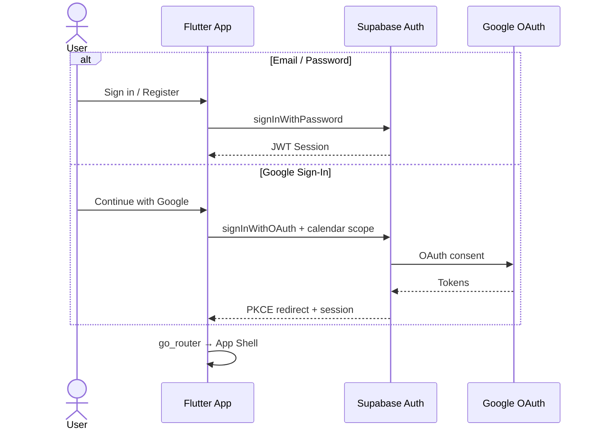

### 5.2 Event Registration & QR Check-in

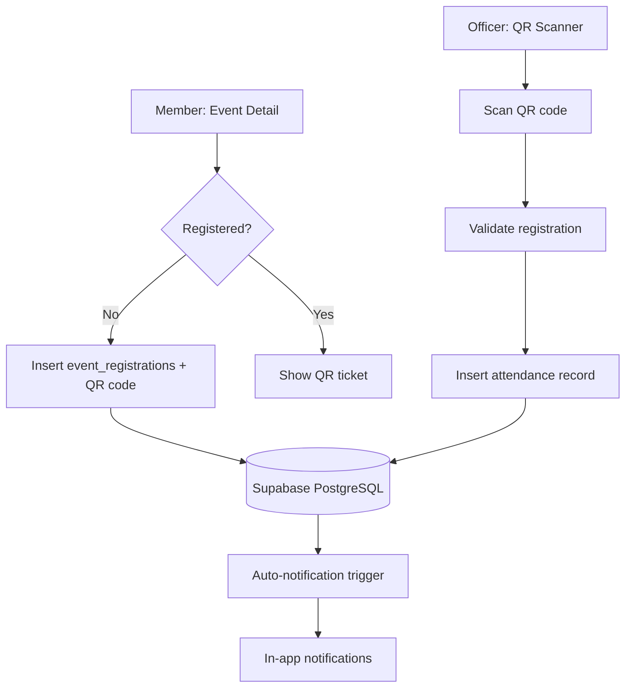

### 5.3 Google Calendar Integration

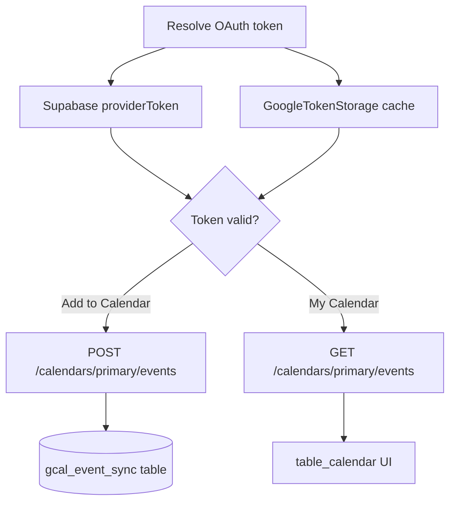

## 6. Entity-Relationship Diagram (ERD)

Relationships are split by domain so each diagram stays large and readable. Cardinality: `||--||` one-to-one, `||--o{` one-to-many, `||--o|` one-to-zero-or-one.

### 6.1 Identity & Profiles

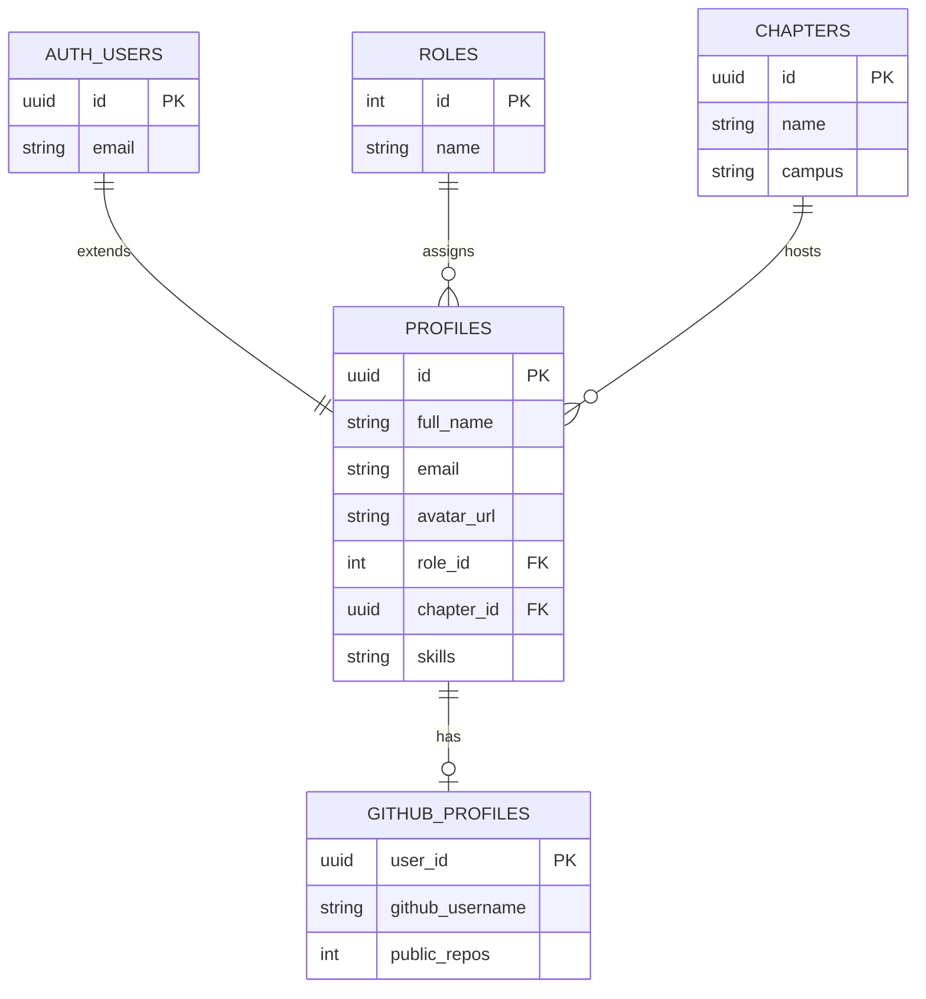

### 6.2 Events, Attendance & Career Hub

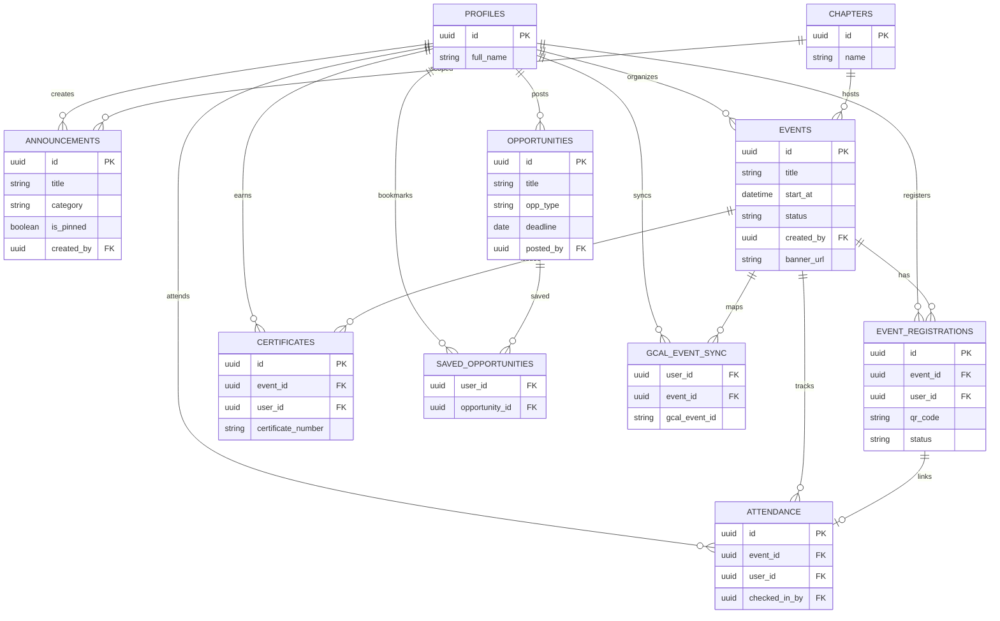

### 6.3 Partnerships, Analytics & Notifications

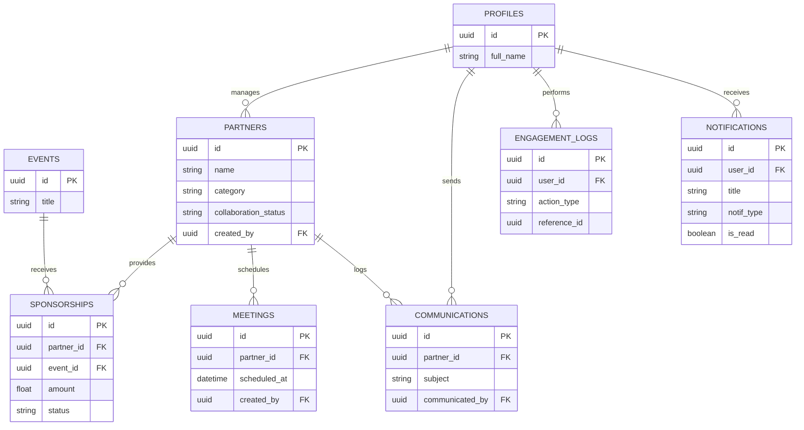

## 7. Database Table Reference

All tables live in `public` schema on Supabase PostgreSQL. Primary keys are UUID unless noted. Row Level Security (RLS) is enabled on every table.

### 7.1 Core & Identity

| Table | Purpose | Key Columns | Relationships |
|---|---|---|---|
| `roles` | Member (1) / Officer (2) | id PK, name | → profiles.role_id |
| `chapters` | GDGoC campus chapters | id PK, name, campus | → profiles, events, announcements |
| `profiles` | User profile (1:1 auth.users) | id PK/FK, full_name, email, avatar_url, role_id, skills[] | Central hub for most FKs |
| `github_profiles` | Cached GitHub API stats | user_id FK UK, github_username, public_repos | profiles.id |

### 7.2 Community Content

| Table | Purpose | Key Columns | Relationships |
|---|---|---|---|
| `announcements` | Community feed posts | title, body, category, is_pinned, created_by FK | profiles, chapters |
| `events` | Event management | title, start_at, end_at, status, created_by FK, banner_url | profiles, chapters |
| `event_registrations` | Member registration + QR | event_id FK, user_id FK, qr_code UK, status | events, profiles |
| `attendance` | QR / manual check-in | event_id FK, user_id FK, checked_in_by FK | events, profiles, registrations |
| `certificates` | Digital event certificates | event_id FK, user_id FK, certificate_number UK | events, profiles |
| `opportunities` | Career Hub postings | title, organization, type, deadline, posted_by FK | profiles |
| `saved_opportunities` | Member bookmarks | user_id FK, opportunity_id FK | profiles, opportunities |
| `gcal_event_sync` | Google Calendar mapping | user_id FK, event_id FK, gcal_event_id | auth.users, events |

### 7.3 Partnerships & Analytics

| Table | Purpose | Key Columns | Relationships |
|---|---|---|---|
| `partners` | Partner directory | name, category, collaboration_status, created_by FK | profiles |
| `sponsorships` | Sponsorship tracking | partner_id FK, event_id FK, amount, status | partners, events |
| `meetings` | Partner meeting schedule | partner_id FK, scheduled_at, created_by FK | partners |
| `communications` | Partner comm logs | partner_id FK, subject, communicated_by FK | partners, profiles |
| `engagement_logs` | Member analytics actions | user_id FK, action_type, reference_id | profiles |
| `notifications` | In-app + push records | user_id FK, title, type, is_read | profiles (Realtime stream) |

### 7.4 Migration History

| Migration File | Purpose |
|---|---|
| `20260723190000_init_schema.sql` | Core tables, triggers, is_officer() |
| `20260723191000_rls_policies.sql` | Row Level Security on all tables |
| `20260723192000_seed_data.sql` | Sample chapters, events, opportunities |
| `20260817140000_community_points_trigger.sql` | Auto-update profiles.points |
| `20260817150000_event_banners_storage.sql` | event-banners storage bucket |
| `20260817163000_officer_owned_content_policies.sql` | Officer owns their content CRUD |
| `20260817170000_auto_notifications.sql` | DB triggers → notifications |
| `20260819180000_avatars_storage.sql` | avatars storage bucket |
| `20260819190000_gcal_sync.sql` | gcal_event_sync table |

## 8. Storage Buckets & Security

| Bucket | Purpose | Access |
|---|---|---|
| `event-banners` | Event banner images uploaded by officers | Authenticated upload; public read |
| `avatars` | Profile pictures for members & officers | User owns their avatar folder |

### Security Model

- **RLS** — Every table has policies scoped to `auth.uid()`
- **is_officer()** — SQL helper grants elevated access to role_id = 2
- **Officer-owned content** — Officers edit/delete only their own announcements & events
- **PKCE auth** — Password recovery and OAuth use PKCE on web
- **Google tokens** — Cached locally in GoogleTokenStorage; never hardcoded

---

*GoCollab · GDGoC Philippines · SDG 17 — Partnerships for the Goals*
